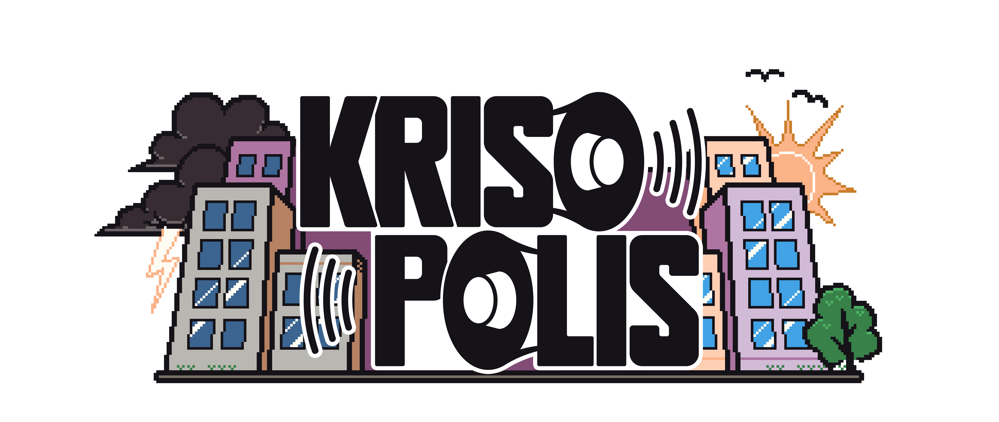

# Krisopolis

**A serious game about crisis preparedness.** Survive power outages, lockdowns and storms in a fictional city, and learn what actually helps in a real crisis.

[Google Play](https://play.google.com/store/apps/details?id=de.tu_darmstadt.krisopolis.android) · [App Store](https://apps.apple.com/de/app/krisopolis/id6478697470) · [Website](https://krisopolis.de/) · [Trailer on YouTube](https://www.youtube.com/watch?v=Mu4yAavImCA&list=PLtH4i5VlDa4y7mhsshb_5316KVgPm5Ok-) · [MIT License](LICENSE.txt)


## About

Krisopolis is a mobile serious game developed at the LOEWE Center [emergenCITY](https://www.emergencity.de/) at TU Darmstadt. Players take on the role of an avatar in the fictional city of Krisopolis, which is constantly hit by crises and disasters such as power outages, lockdowns and storms.

To get through, you have to look after your avatar's basic needs: enough food, clean drinking water, physical fitness and social contact. The key to success is a good preparedness strategy at the start of each round.

The idea for the game came from a group of students during a computer science internship in winter semester 2023/24. It has since been developed further and released by emergenCITY through TU Darmstadt.

## Why a serious game?

Krisopolis aims to raise awareness of crisis situations in an accessible, playful way. Through realistic scenarios, the game conveys information on:

- material precautions (e.g. emergency supplies)
- appropriate behavior in emergency situations
- social strategies for crisis management (e.g. neighborhood networks and mutual aid)

The goal is to strengthen the resilience of individuals and communities so they are better prepared for real crises.

## How it works

- **Preparation phase:** before each crisis, you get ready, for example by buying food and other supplies.
- **Crisis phase:** you survive the crisis without neglecting your avatar's needs.
- **Community:** not every crisis can be overcome alone. The residents of the neighborhood exchange information, support each other and trade goods.
- **Rewards:** smart decisions earn eCoins, which you can invest in new supplies and equipment. This lets you get through longer and harder crises.
- **Real-world tips:** the game also gives practical advice for crisis preparedness in real life.

## Features

- Free to play
- Made for smartphones and tablets
- Small storage size, no permanent internet connection needed
- Accessibility: colorblind-friendly color scheme, dyslexia-friendly font, haptic feedback for players with hearing impairments
- Language: German 

## Download

| Platform | Link                                                                                            |
| -------- | ----------------------------------------------------------------------------------------------- |
| Android  | [Google Play](https://play.google.com/store/apps/details?id=de.tu_darmstadt.krisopolis.android) |
| iOS      | [App Store](https://apps.apple.com/de/app/krisopolis/id6478697470)                              |

## Repository structure

| Folder | Contents |
|---|---|
| `godot/` | The Godot project (game source code and assets) |
| `doc/` | Architecture and flow diagrams (draw.io) |
| `bin/` | Early preview builds (Android .apk, Windows .exe) from 2023/24 |
| `licenses_3rd_party/` | Licenses of third-party assets and libraries |

Inside `godot/`:

| Folder / file                        | Contents                                                   |
| ------------------------------------ | ---------------------------------------------------------- |
| `preparePhase/`, `crisisPhase/`      | Logic and scenes for the two game phases                   |
| `inventory/`                         | Inventory and items                                        |
| `GUI/`                               | User interface and theme                                   |
| `global/`                            | Global managers (autoloads) and the entry scene            |
| `res/`                               | Resources such as the NPC dialogue files (`res/dialogue/`) |
| `resources/`, `JSONs/`               | Game data                                                  |
| `assets/`, `animations/`, `shaders/` | Art, sound, animations, shaders                            |
| `util/`                              | Helper scripts                                             |
| `project.godot`                      | Godot project file (open this one)                         |
| `export_presets.cfg`                 | Export settings for the app builds                         |

The diagrams in `doc/` cover the game flow (day manager, stage manager and avatar), the software layers and the software architecture (game framework, preparation phase, crisis phase, GUI and actions, items and inventory). They are a good starting point to understand how the code is organized. Note that they date from 2023, so they may not match the current code exactly.

> **Note:** the builds in `bin/` are old preview versions. For the current version, please use the app stores above.

## Building from source

**Requirements**

- [Godot Engine](https://godotengine.org/) **4.2** (Mobile renderer)

**Run the project**

1. Clone the repository:

```bash

   git clone https://github.com/LOEWE-emergenCITY/Krisopolis.git

```

2. Open Godot and import `godot/project.godot`.

3. Press **F5** to run. The main scene is `res://global/entry.tscn`.

The game is designed for portrait mode (576 × 1024). On desktop, mouse clicks are treated as touch input, and the avatar can be moved with **W / A / S / D**.

**Export**

Export presets are defined in `godot/export_presets.cfg`.

## Contributing

Bug reports and suggestions are welcome. Please open an [issue](https://github.com/LOEWE-emergenCITY/Krisopolis/issues). For code changes, open an issue first to discuss the idea, then submit a pull request.

## License

This project is licensed under the [MIT License](LICENSE.txt).

Third-party assets and libraries have their own licenses, see [`licenses_3rd_party/`](licenses_3rd_party/). This includes the OpenDyslexic font (used for the dyslexia-friendly option), the Gugi font, the sound effects and the Godot add-ons.

## Credits

**Original student team from TU Darmstadt (winter semester 2023/24):**

Ole Fabritz, Michelle Geisler, Jakob Huth, Karina M. Lazarova, Marcos Rizig-Mursal

All code contributors are listed on the [contributors page](https://github.com/LOEWE-emergenCITY/Krisopolis/graphs/contributors).

Krisopolis is developed by an interdisciplinary team of scientists and students at TU Darmstadt within the LOEWE Center emergenCITY. emergenCITY has researched the resilience of digital cities since 2020, with the participation of TU Darmstadt, the University of Kassel and Philipps University of Marburg.

## Contact

LOEWE Center emergenCITY, TU Darmstadt

[manager@emergencity.de](mailto:manager@emergencity.de)
